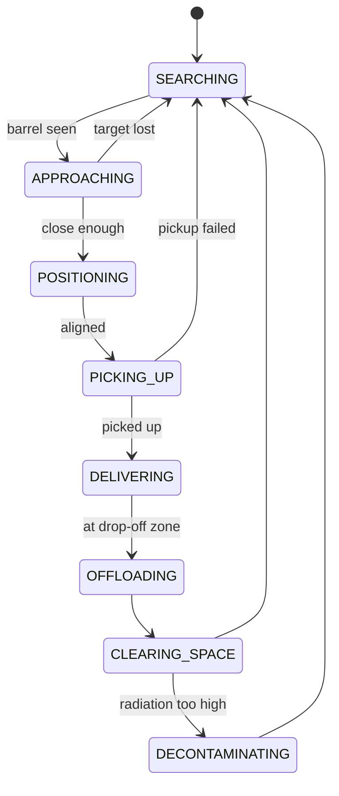

# Autonomous Multi-Robot Barrel Collection (ROS2)

University of York, Autonomous Robotics (AURO) assessment, January 2026.

A team of TurtleBot3 Waffle Pi robots patrols a simulated Gazebo arena, finds contaminated barrels with a
camera, picks them up, delivers them to a drop-off zone, and decontaminates itself when its radiation dose
gets too high, all without human input.

> **Where the code is:** my solution lives in [`solution/`](solution). The other packages
> (`assessment`, `assessment_interfaces`, `auro_interfaces`, `env_lab`, `week_*`) are the course-provided
> simulation, message definitions, and weekly lab exercises.

## How it works

Each robot runs its own `robot_controller` node (namespaced `robot1`, `robot2`, ...) built around an
**8-state finite state machine**:



| State | What the robot does |
|---|---|
| `SEARCHING` | Patrols with Nav2 waypoints until the camera reports a barrel |
| `APPROACHING` | Picks the best barrel and steers to it with proportional visual servoing |
| `POSITIONING` | Aligns, turns around and backs up so the rear holder lines up (`CollectPhase`) |
| `PICKING_UP` | Calls the `/pick_up_item` service |
| `DELIVERING` | Navigates with Nav2 to the drop-off zone |
| `OFFLOADING` | Calls `/offload_item` |
| `CLEARING_SPACE` | Moves away so it doesn't block teammates |
| `DECONTAMINATING` | Drives to the cyan zone, reverses in and calls `/decontaminate` |

Other details:

- **Obstacle avoidance:** the LiDAR scan is split into front / left / right sectors and the closest reading
  in each drives avoidance. A dynamic LiDAR mask is toggled while carrying a barrel so the barrel isn't
  seen as an obstacle.
- **Multi-robot:** every robot reads the shared `/barrel_holders` and `/radiation_levels` topics so robots
  don't chase the same barrel.
- **Logging:** `data_logger` writes per-second counts of collected barrels and radiation to CSV.

## Results

Validated across five 3-hour test scenarios (different seeds and robot counts) with 90 to 100% barrel
detection accuracy. Sample logs: `data_log_*.csv`.

## Running it

Requires Docker and VS Code with the Dev Containers extension. Open this repo in the dev container
(`.devcontainer/devcontainer.json` gives a browser desktop at http://localhost:6080), then:

```bash
colcon build --symlink-install
source install/setup.bash
ros2 launch solution solution_launch.py num_robots:=2 random_seed:=1 experiment_duration:=600.0
```

Useful launch arguments: `num_robots`, `random_seed`, `experiment_duration` (seconds), `headless`,
`use_rviz`, `sensor_noise`, `data_log_filename`.

## Tech

Python, ROS2, Nav2 (`nav2_simple_commander`), Gazebo, TurtleBot3, Docker
